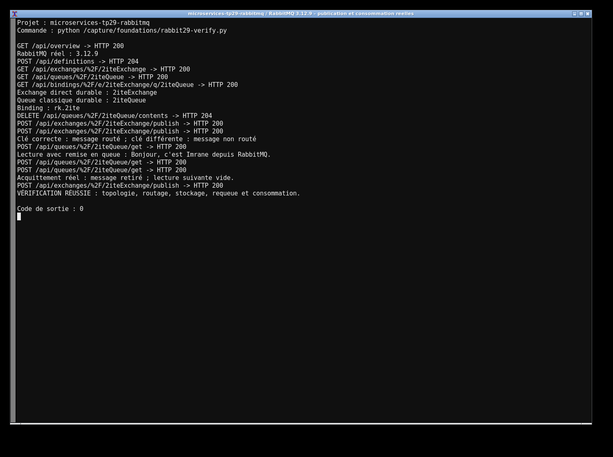
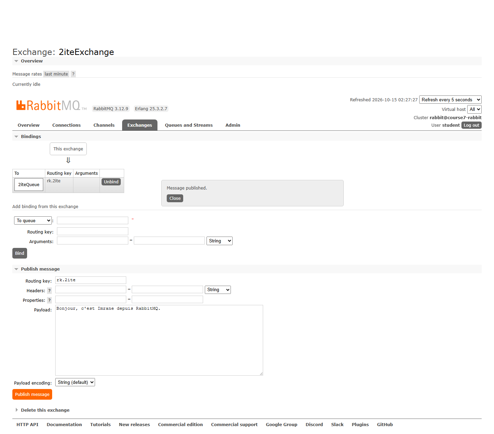
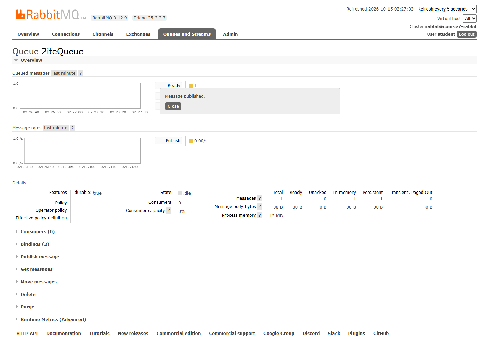
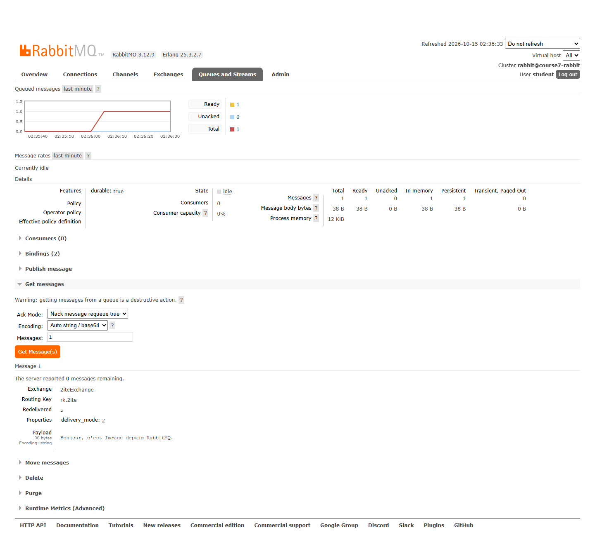

# TP29 — RabbitMQ Management

J'ai créé l'exchange direct durable `2iteExchange`, la queue durable `2iteQueue` et leur binding avec la clé `rk.2ite`. Le message passe par l'exchange avant d'arriver dans la queue. Dans un exchange direct, la clé publiée doit correspondre exactement à celle du binding.

```sh
docker compose up -d
docker compose ps
```

L'interface Management est sur `http://localhost:19629` : `student` / `student-lab-only` (compte réservé au lab). Le port AMQP est `15629`. Les exemples JSON permettent de retrouver la topologie et le message utilisés. Dans Get messages, `ack_requeue_true` remet le message dans la queue ; `ack_requeue_false` le retire. Les captures montrent la publication, le message en attente puis sa lecture. Pour arrêter : `docker compose down`, sans `-v` pour garder les données.

Les traces d'exécution sont dans `evidence/` et les captures dans `screenshots/`.





